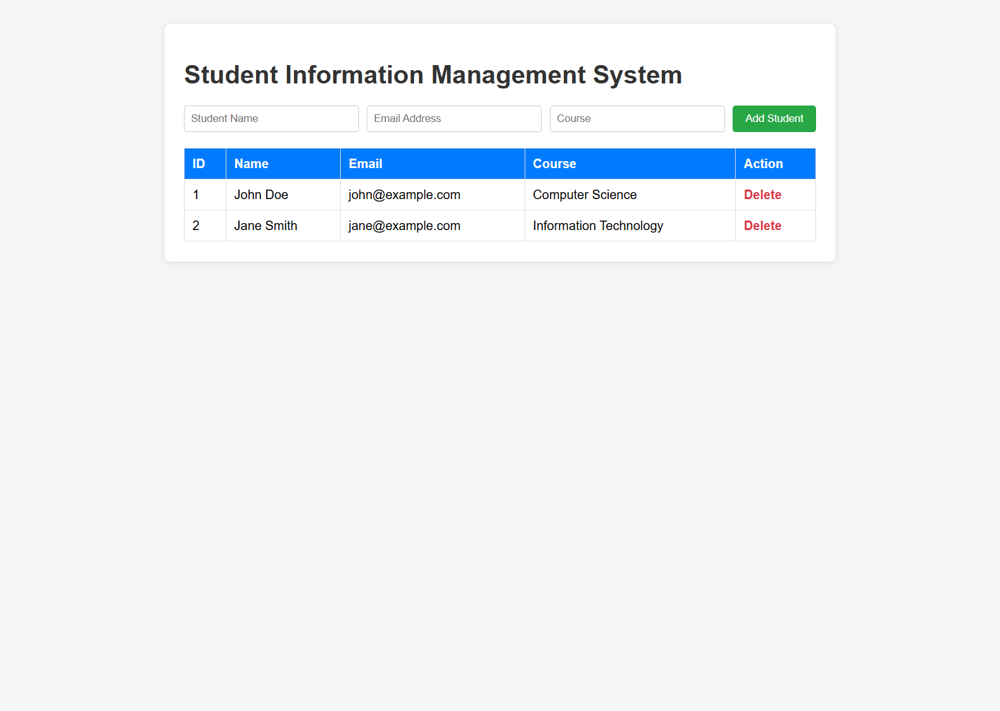
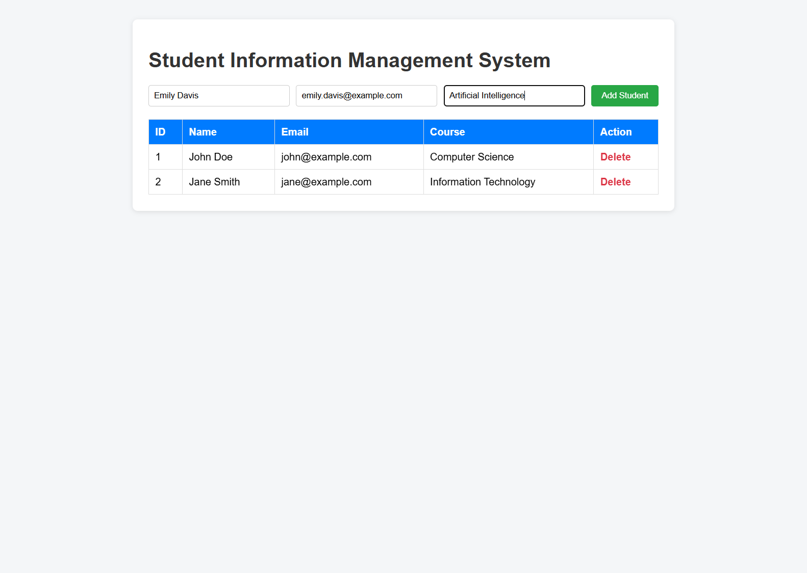
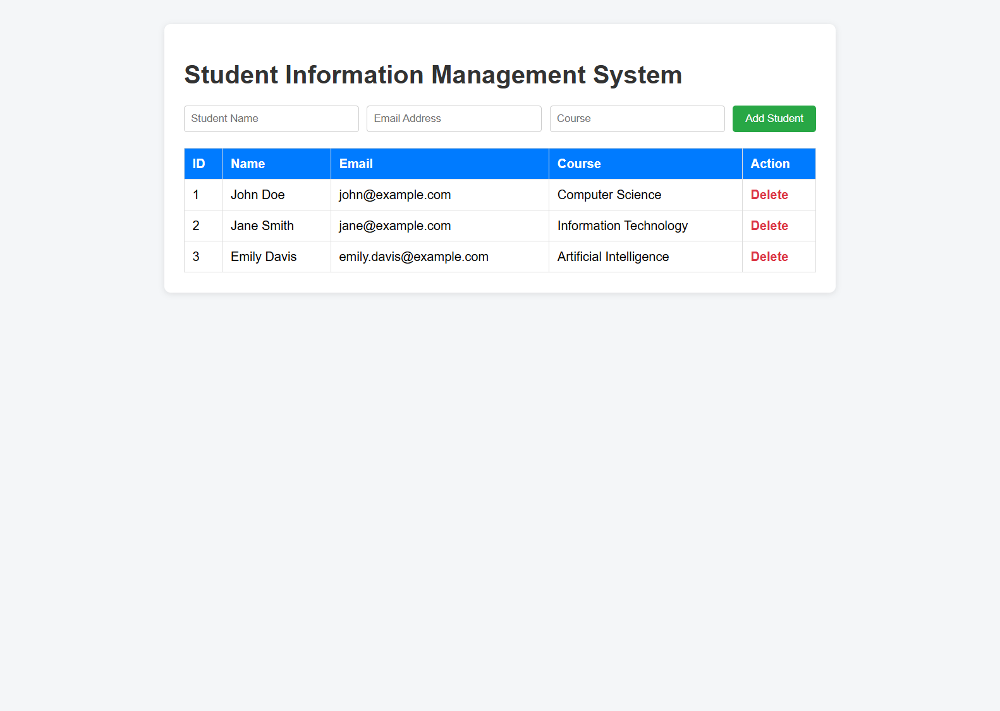
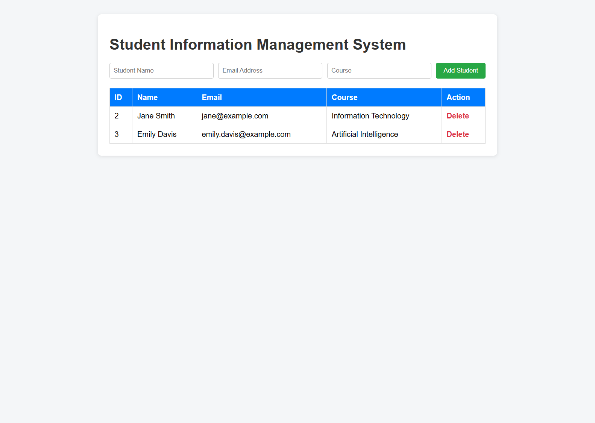
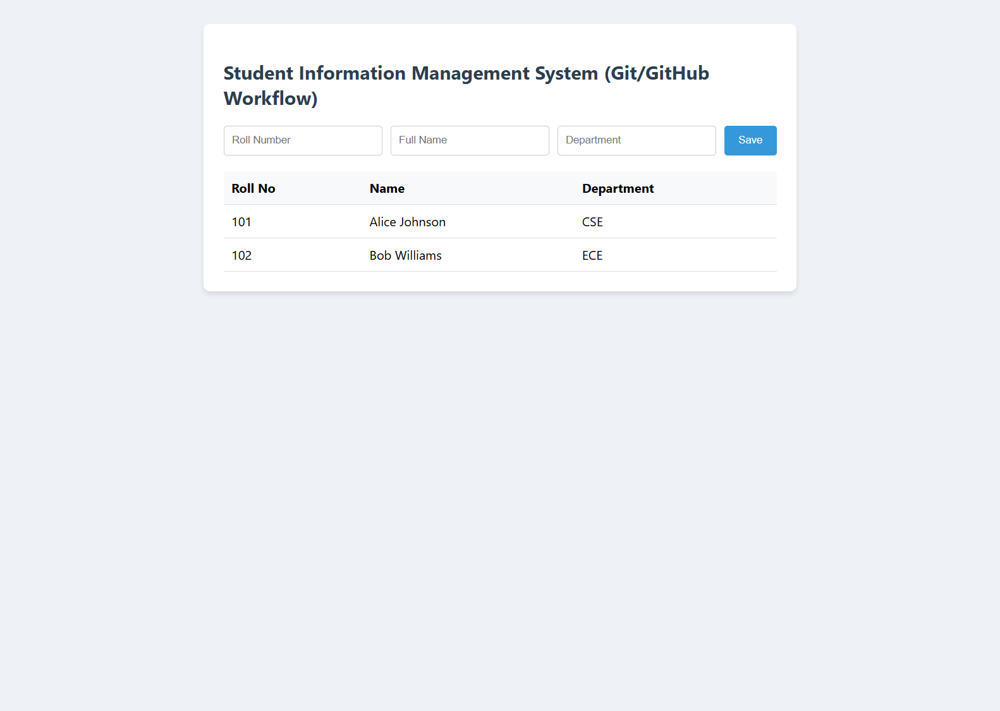
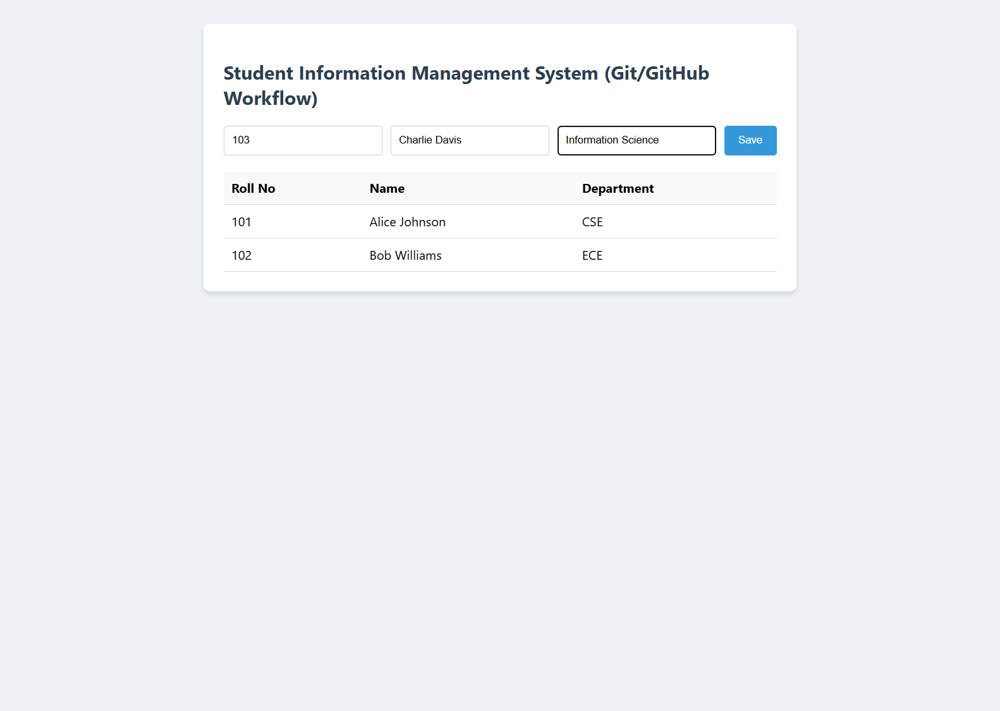
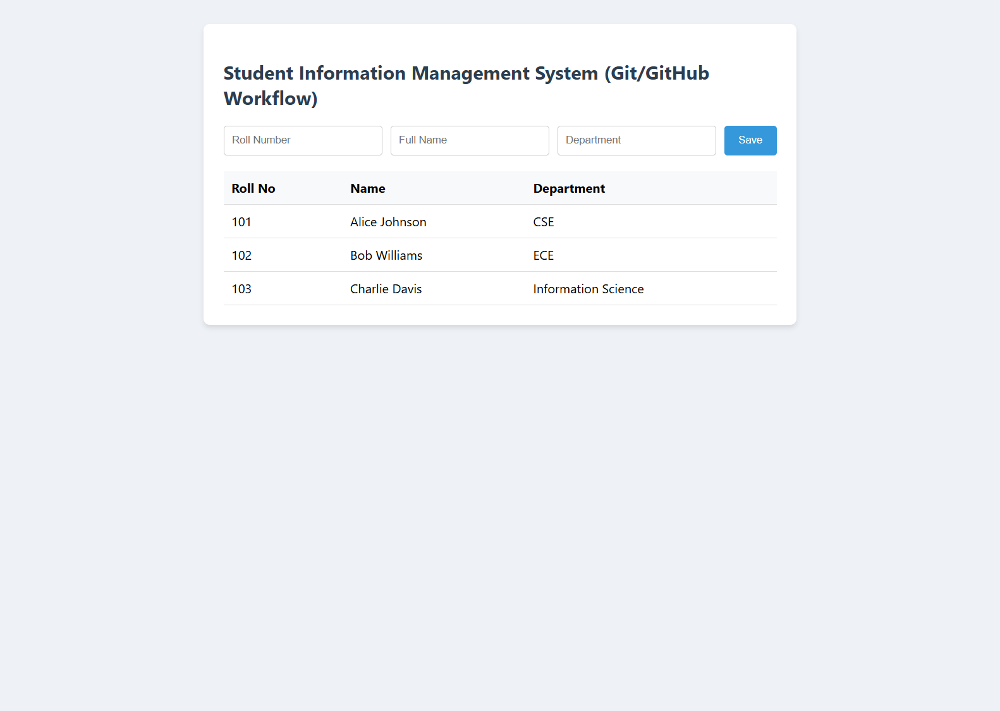
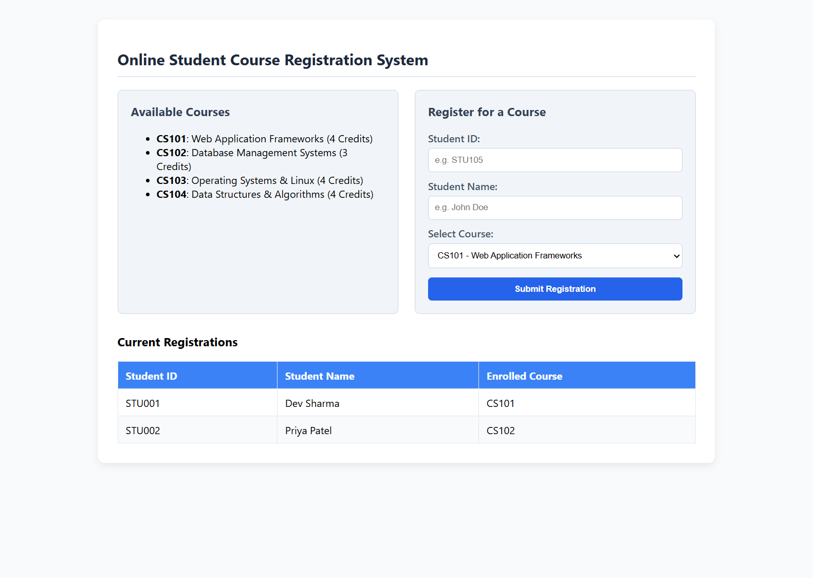
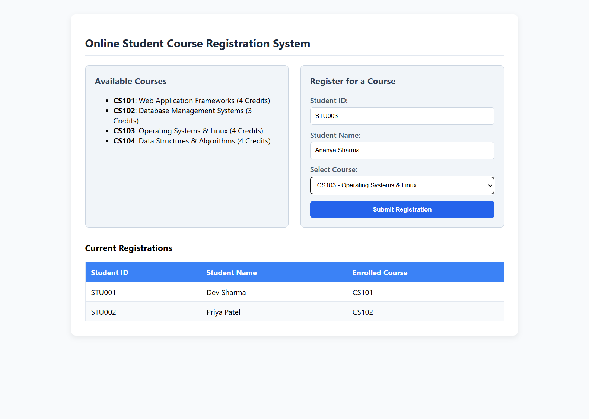

# Week-8: Web Application Frameworks & Git Workflow

## Table of Contents
1. [Part (a): Student Information Management System & Git Branch Management](#part-a-student-information-management-system--git-branch-management)
   - [1. Overview](#1-overview)
   - [2. How to Run the App](#2-how-to-run-the-app)
   - [3. Step-by-Step Git Commands & Output](#3-step-by-step-git-commands--output)
   - [4. Application Screenshots](#4-application-screenshots)
2. [Part (b): Student Information Management System & Git/GitHub Workflow](#part-b-student-information-management-system--gitgithub-workflow)
   - [1. Overview](#1-overview-1)
   - [2. How to Run the App](#2-how-to-run-the-app-1)
   - [3. Step-by-Step Git & GitHub Commands & Output](#3-step-by-step-git--github-commands--output)
   - [4. Application Screenshots](#4-application-screenshots-1)
3. [Part (c): Online Student Course Registration System & Complete Git Workflow](#part-c-online-student-course-registration-system--complete-git-workflow)
   - [1. Overview](#1-overview-2)
   - [2. How to Run the App](#2-how-to-run-the-app-2)
   - [3. Step-by-Step Complete Git Workflow Commands & Output](#3-step-by-step-complete-git-workflow-commands--output)
   - [4. Application Screenshots](#4-application-screenshots-2)

---

## Part (a): Student Information Management System & Git Branch Management

### 1. Overview
A Flask application that allows viewing, adding, and deleting student records. It demonstrates Git branching lifecycle:
- Creating a branch
- Switching branches
- Merging branches
- Deleting branches

### 2. How to Run the App
```bash
python3 part_a/app.py
# Access at: http://127.0.0.1:5000/
```

### 3. Step-by-Step Git Commands & Output
```bash
# 1. Initialize repo and initial commit
git init -b main
git add app.py templates/
git commit -m "Initial commit: Basic Student Information Management System"

# 2. Create a new branch
git branch feature-search
git branch
# Output:
#   feature-search
# * main

# 3. Switch to the new branch
git checkout feature-search
# Output: Switched to branch 'feature-search'

# 4. Modify files and commit on branch
git add app.py
git commit -m "feat: Add search module placeholder on feature branch"

# 5. Switch back to main branch
git checkout main
# Output: Switched to branch 'main'

# 6. Merge the feature branch into main
git merge feature-search -m "Merge branch 'feature-search' into main"
# Output: Updating 44979ae..34c2467 (Fast-forward)

# 7. Delete the merged branch
git branch -d feature-search
# Output: Deleted branch feature-search (was 34c2467).

# 8. Verify commit log
git log --oneline --graph
```

### 4. Application Screenshots

#### 4.1 Initial Student List View
Displays the initial student database records (`John Doe`, `Jane Smith`), table action links, and the empty student input form.


#### 4.2 Adding a New Student Record
Demonstrates filling out the student input form with new details (`Emily Davis`, `emily.davis@example.com`, `Artificial Intelligence`).


#### 4.3 Student Added Successfully
Displays the updated student database table with the newly registered student record dynamically appended.


#### 4.4 Deleting a Student Record
Demonstrates record removal when the "Delete" action is clicked, updating the table immediately.


---

## Part (b): Student Information Management System & Git/GitHub Workflow

### 1. Overview
A Flask application for managing student roll numbers, names, and departments. It demonstrates the standard Git and GitHub remote workflow:
- Setting up a remote repository
- Cloning to local system
- Adding and modifying project files
- Staging (`git add`) and committing (`git commit`)
- Pushing to remote (`git push`)

### 2. How to Run the App
```bash
python3 part_b/app.py
# Access at: http://127.0.0.1:5001/
```

### 3. Step-by-Step Git & GitHub Commands & Output
```bash
# 1. Clone remote repository to local system
git clone https://github.com/<username>/student-mgmt.git local_repo
cd local_repo

# 2. Add project files
# (Copy app.py and templates/ into local_repo)
git status
# Output: Untracked files: app.py, templates/

# 3. Stage and commit files
git add app.py templates/
git commit -m "feat: Initial commit of Student Information Management System"
# Output: [main (root-commit) 58d61d8] feat: Initial commit...

# 4. Push to GitHub remote
git push origin main
# Output: To https://github.com/... * [new branch] main -> main

# 5. Modify files and push updates
echo "# Updated with logging support" >> app.py
git add app.py
git commit -m "chore: Update app.py with logging comment"
git push origin main
# Output: 58d61d8..ab25235 main -> main

# 6. Verify remote and commit log
git remote -v
git log --oneline
```

### 4. Application Screenshots

#### 4.1 Initial Student Management Page
Displays pre-existing enrolled student records (`Alice Johnson`, `Bob Williams`) and the registration form for roll number, name, and department.


#### 4.2 Student Registration Form Entry
Demonstrates entering new student details (`Roll No: 103`, `Name: Charlie Davis`, `Department: Information Science`).


#### 4.3 Student Successfully Registered
Displays the updated student records table displaying the new entry added via the POST request.


---

## Part (c): Online Student Course Registration System & Complete Git Workflow

### 1. Overview
A Flask web application for online student course registration with course listing, registration form, and enrollment table. It demonstrates the complete end-to-end Git workflow:
- Repository Initialization (`git init`)
- File tracking and staging (`git add`)
- Committing changes (`git commit`)
- Remote repository setup & management (`git remote add origin`, `git push -u`)
- Branching (`git checkout -b`)
- Merging (`git merge`)
- Collaborative development (`git clone`, collaborator commit/push, and `git pull`)

### 2. How to Run the App
```bash
python3 part_c/app.py
# Access at: http://127.0.0.1:5002/
```

### 3. Step-by-Step Complete Git Workflow Commands & Output
```bash
# 1. Initialize Git repository
git init -b main

# 2. Track & stage project files
git add app.py templates/
git status -s
# Output:
# A  app.py
# A  templates/index.html

# 3. Commit staged changes
git commit -m "feat: Initial commit of Online Student Course Registration System"

# 4. Add Remote repository & push
git remote add origin https://github.com/<username>/course-registration.git
git push -u origin main

# 5. Create and switch to a feature branch
git checkout -b feature-course-limit

# 6. Modify code on branch & commit
echo "# Added course limit logic placeholder" >> app.py
git add app.py
git commit -m "feat(courses): Add maximum enrollment limit validation"

# 7. Merge branch into main & delete feature branch
git checkout main
git merge feature-course-limit
git branch -d feature-course-limit
git push origin main

# 8. Collaborative Development
# (Collaborator clones and contributes)
git clone https://github.com/<username>/course-registration.git collaborator_workspace
cd collaborator_workspace
# Collaborator modifies app.py:
git add app.py
git commit -m "collab: Add registration audit logging"
git push origin main

# (Original developer pulls updates)
cd /path/to/original/repo
git pull origin main
# Output: Updating 37e6dab..293496a (Fast-forward)

# 9. Verify full commit history graph
git log --graph --oneline --all
# Output:
# * 293496a collab: Add registration audit logging
# * 37e6dab feat(courses): Add maximum enrollment limit validation
# * 4c84ae3 feat: Initial commit of Online Student Course Registration System
```

### 4. Application Screenshots

#### 4.1 Course Registration Dashboard
Displays the available courses card (`CS101`, `CS102`, `CS103`, `CS104`), student course registration form, and current registrations table.


#### 4.2 Registering for a Course
Demonstrates filling out the registration form (`Student ID: STU003`, `Student Name: Ananya Sharma`) and selecting `CS103 - Operating Systems & Linux` from the dropdown.


#### 4.3 Course Registration Submitted
Displays the updated Current Registrations table with the new course enrollment recorded and rendered.

